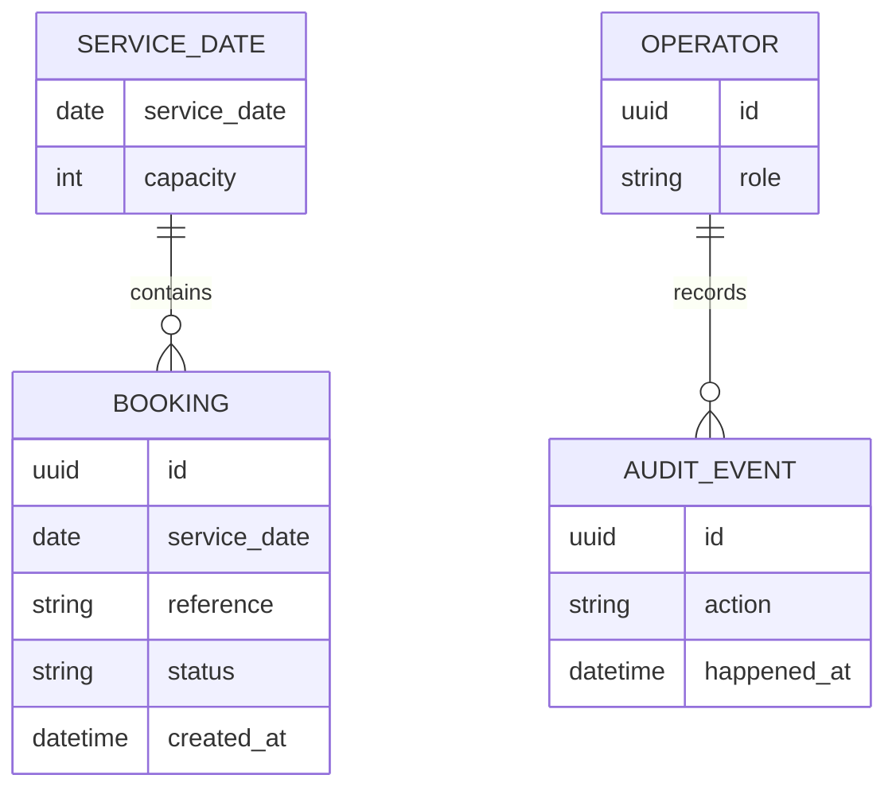

# Модель данных (черновик)

Предлагаемые сущности, поля не утверждены и требуют data-minimization review.

Никаких паспортных фотографий в начальной схеме. Инвариант: активных броней на дату не более 100. Механизм конкурентного доступа требует отдельного архитектурного решения.