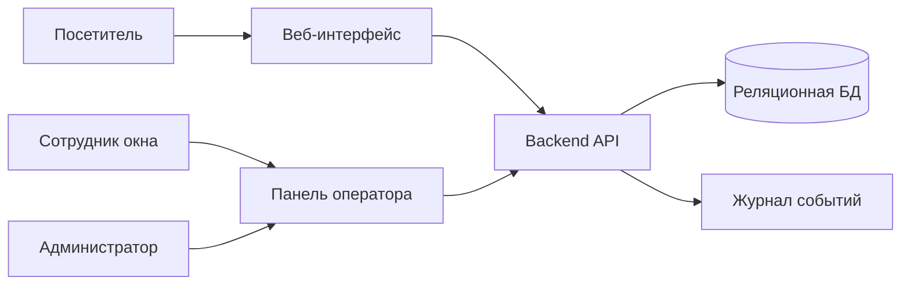

# Архитектура: предварительная концепция

Стек и границы сервисов являются предложением для MVP, не утвержденным решением.

## Принципы
- Транзакционное ограничение количества записей в БД.
- Сервер проверяет все правила независимо от интерфейса.
- Отдельные роли; минимально необходимые персональные данные.
- Нет прямого доступа браузера к БД.
- Административные операции журналируются с исключением чувствительных значений.

## Не решено
Фреймворки, структура deployment, интеграции, схема авторизации, QR-код, SMS/e-mail уведомления, временное хранение паспортов. До утверждения этих решений нельзя считать диаграмму финальной.